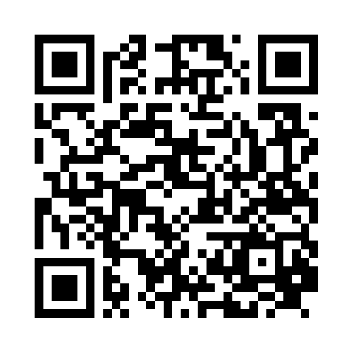

# 復元せよ　土器・土偶・埴輪

こなごなに割れた出土品を、3Dのピースを組み合わせて復元するブラウザゲームです。

| ステージ | 出土品 | ピース数 | 難易度 |
| --- | --- | --- | --- |
| 1 | 火焔型土器（縄文時代中期） | 10 | ★☆☆☆☆☆☆☆☆ |
| 2 | 遮光器土偶（縄文時代晩期） | 12 | ★★☆☆☆☆☆☆☆ |
| 3 | 縄文のビーナス（縄文時代中期・国宝） | 14 | ★★★☆☆☆☆☆☆ |
| 4 | 仮面の女神（縄文時代後期・国宝） | 16 | ★★★★☆☆☆☆☆ |
| 5 | 寅さん埴輪（古墳時代後期） | 18 | ★★★★★☆☆☆☆ |
| 6 | 馬形埴輪（古墳時代後期） | 20 | ★★★★★★☆☆☆ |
| 7 | 挂甲の武人（古墳時代後期・国宝） | 22 | ★★★★★★★☆☆ |
| 8 | ハート形土偶（縄文時代後期・重要文化財） | 22 | ★★★★★★★★☆ |
| 9 | 埴輪 踊る人々（古墳時代後期） | 24 | ★★★★★★★★★ |

## 遊び方

1. タイトル画面では完成した姿が表示されます。ドラッグ／フリックで回して観察できます。
2. 「復元スタート」を押すと、土器がこなごなに割れます。
   ステージが進むほど、ピースが増え、はまる判定がきびしくなり、完成形のガイドがうすく（最後は最初から非表示に）なります。
3. ピースをドラッグして、正しい位置に近づけると **ピタッ** とはまります。
   - まずは一番下（底）のピースから。そのあとは、はまっているピースにつながる所から順に組み上げます。
4. 何もないところをフリックすると、器のまわりを回ったり、上から見下ろしたりできます。
5. 「ヒント」で次にはめられるピースとその場所が光ります。「ガイド」で完成形のうすい影を表示／非表示。

## 動かし方（ローカル）

ビルド不要の静的サイトです。ES Modules を使うため、ファイルを直接開くのではなくローカルサーバーで配信してください。

```bash
npx http-server -p 8080
```

ブラウザで http://localhost:8080 を開きます。

## GitHub Pages で公開する

1. GitHub のリポジトリページで **Settings → Pages** を開く
2. **Build and deployment** の **Source** を「**Deploy from a branch**」にする
3. **Branch** で `main`、フォルダは `/ (root)` を選んで **Save**
4. 1〜2分待つと `https://<ユーザー名またはOrg名>.github.io/<リポジトリ名>/` で公開されます

## Android アプリ

[Capacitor](https://capacitorjs.com/) で Web 版をそのまま Android アプリにしています（パッケージ名 `jp.techgym.doki`、縦画面）。
ゲームのファイルはアプリに同梱するので、オフラインでも遊べます。

- 動作確認用 APK（テスト広告・デバッグ署名）：`main` に push するたびに GitHub Actions がビルドして、Release に載せます
  - リリース画面：https://github.com/techgymjp/doki/releases/tag/android-latest
  - APK を直接：https://github.com/techgymjp/doki/releases/latest/download/doki.apk
  - スマホで読み取る QR コード（リリース画面）：

    

- Google Play 用の署名付き AAB：リポジトリの Secrets（`ANDROID_KEYSTORE_BASE64` など 4 つ）があるとき、本番広告でビルドして Actions の Artifact（`doki-release-aab`）に上げます
- 広告（AdMob、`js/ads.js`）：アプリのときだけ動き、Web 版では何もしません
  - バナー：タイトル・あそびかた・ポーズ・結果画面の下中央だけ（プレイ中は出さない）
  - 全画面広告：プレイを始めるとき、トップにもどるとき、ポーズからの再開、結果画面からの「もう一度」「次のステージへ」
  - リワード広告：「おまかせ」ボタンで広告を最後まで見ると、次のピースが自動ではまる（1 ステージ 5 回まで。結果画面とシェア文に回数を出す）
- 戻るボタン：プレイ中はポーズ、タイトルや結果画面ではアプリを終了。別のアプリに切り替えると自動でポーズします

```bash
npm ci
npm run build            # www/ にコピー（ADMOB_MODE=production で本番広告）
npx cap sync android     # android/ に反映（ビルドは Android Studio か GitHub Actions で）
```

## ライセンス

著作権はテックジム株式会社に帰属します（All rights reserved）。許可なく複製・改変・再配布すること、Web サイトやアプリ（Google Play、App Store など）として公開・販売すること、名前・アイコン・画像を使うことを禁止します。
テックジムの受講生が学習目的で複製・改変することは許可しますが、アプリストアでの公開・広告の掲載・販売などの商用利用は禁止します。
同梱の three.js は MIT License です。詳しくは [LICENSE](LICENSE) を見てください。

## しくみ

- 3D描画は [three.js](https://threejs.org/)（`vendor/three/` に同梱。アプリ版をオフラインで遊べるようにするため）。
- 器は回転体の「厚みのある殻」として、断面曲線＋文様（隆線・渦巻）＋口縁の突起の形（距離関数）から**プログラムで生成**しています。
  画像や3Dモデルのファイルは使っていません。
- 割れ方は毎回ランダム（ゆがませたボロノイ分割）。外面・内面・割れ口の面を持つピースを作ります。
- 効果音・BGM（陽音階のおだやかな曲）・時計の音は Web Audio API で合成しています（音声ファイルなし）。

### ファイル構成

```
index.html
css/style.css
vendor/three/         three.js（同梱）
js/ads.js             広告（アプリ版だけ動く）
scripts/build-web.js  アプリに入れるファイルを www/ にまとめる
android/              Android アプリ（Capacitor）
js/main.js            画面遷移・UI
js/game.js            シーン、割れる演出、ドラッグとスナップ
js/shell.js           回転体（土器など）の殻の生成とピース分割・テクスチャ描画
js/sdfbuild.js        距離関数で表した立体（土偶など）の中空の殻の生成とピース分割・文様シェーダー
js/noise.js           乱数・ノイズ
js/audio.js           効果音
js/artifacts/index.js ステージの一覧と順番
js/artifacts/kaen.js  火焔型土器の形・文様・解説
js/artifacts/dogu.js  遮光器土偶の形・文様・解説
js/artifacts/venus.js 縄文のビーナスの形・文様・解説
js/artifacts/megami.js 仮面の女神の形・文様・解説
js/artifacts/tora.js  寅さん埴輪の形・解説
js/artifacts/uma.js   馬形埴輪の形・解説
js/artifacts/bujin.js 挂甲の武人の形・文様・解説
js/artifacts/heart.js ハート形土偶の形・文様・解説
js/artifacts/odoru.js 埴輪 踊る人々（2体）の形・解説
js/artifacts/common-sdf.js 距離関数の共通部品
```

### ステージ（出土品）を追加するには

`js/artifacts/` に定義ファイルを作り、`js/artifacts/index.js` の `STAGES` に順番どおり登録します（`pieces` でピース数を指定）。
前のステージをクリアすると次のステージが遊べるようになります（クリア状況はブラウザに保存）。
回転体の器（土器・壺・埴輪の円筒部など）は `kaen.js` と同じ形式（断面 `profile`、文様 `relief`、輪郭 `sdf`、色 `color`）で作れます。
土偶のような回転体でない形は `dogu.js` と同じ形式（`type: 'sdf'`、外形の距離関数 `sdf`、空洞の `core`、文様の `patternGLSL`）で作れます。

動作確認用に、URL に `?all` を付けると全ステージが選べ、`?stage=2` でそのステージから始まります。

※ 3Dモデルは各出土品の特徴をもとに生成したもので、特定の実物を正確に再現したものではありません。
